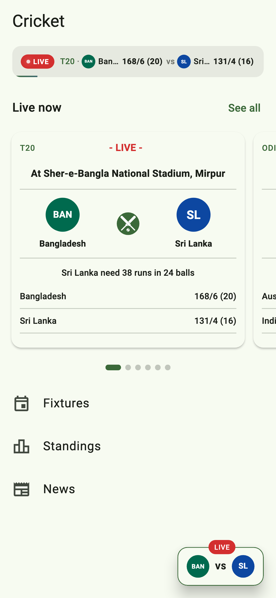
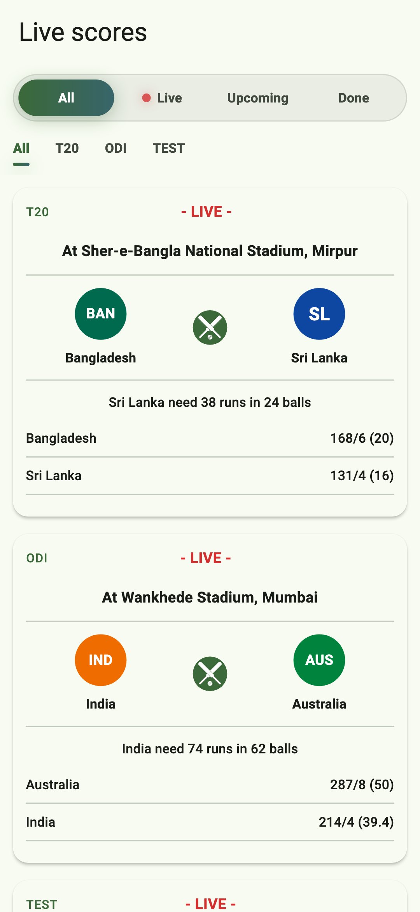
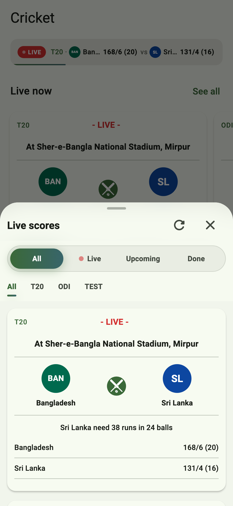
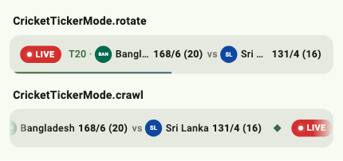
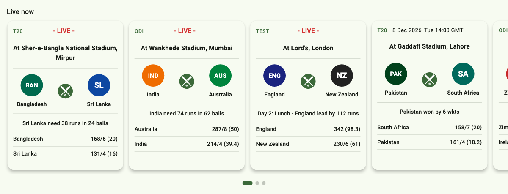
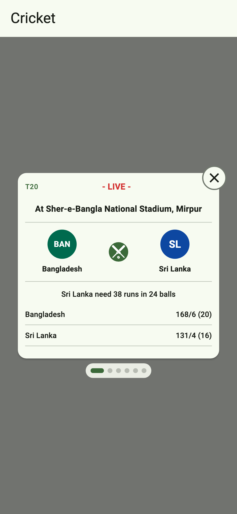
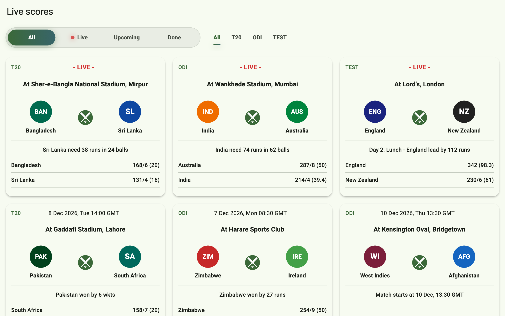
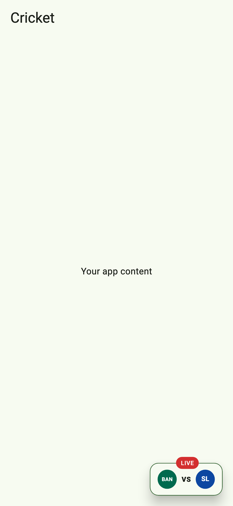
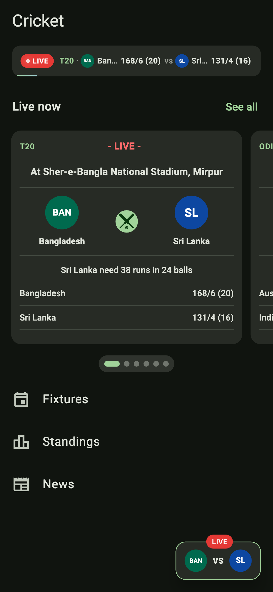

# cricket_live_score

[](https://pub.dev/packages/cricket_live_score)
[](https://github.com/asfakur-rahat/cricket_live_score/blob/main/LICENSE)
[](https://flutter.dev)

Live cricket scores for Flutter apps. Drop in a score ticker, a carousel, a full score screen or a bottom sheet. Each one fetches the matches, keeps them up to date and handles loading, empty and error states. Use the included cricketdata.org source, or plug in your own API.

| Home page | Score screen | Bottom sheet |
|:---:|:---:|:---:|
|  |  |  |

## Contents

- [Features](#features)
- [Getting started](#getting-started)
- [Widgets](#widgets)
  - [Score ticker](#score-ticker)
  - [Inline carousel](#inline-carousel)
  - [Popup carousel](#popup-carousel)
  - [Live score screen](#live-score-screen)
  - [Bottom sheet](#bottom-sheet)
  - [Floating match button](#floating-match-button)
  - [A single match card](#a-single-match-card)
  - [Options every widget shares](#options-every-widget-shares)
- [Data](#data)
- [Customization](#customization)
- [Accessibility](#accessibility)
- [Limitations](#limitations)
- [Example app](#example-app)

## Features

| You want… | Use |
|---|---|
| A slim strip of live scores at the top of a screen | [`CricketScoreTicker`](#score-ticker) |
| A row of match cards inside a page | [`CricketInlineScoreCarousel`](#inline-carousel) |
| Swipeable match cards in a popup | [`CricketLiveScoreCarousel`](#popup-carousel) |
| A full score screen with filters | [`CricketLiveScoreView`](#live-score-screen) |
| The score screen in a bottom sheet | [`showCricketLiveScoreSheet`](#bottom-sheet) |
| One featured match on a floating button | [`CricketMatchFab`](#floating-match-button) |
| A match card in your own layout | [`CricketMatchCard`](#a-single-match-card) |

- **Always up to date:** polls for new scores every 30 s, pauses while the app is in the background, and keeps the last scores on screen if a poll fails.
- **Adaptive:** phones, tablets, foldables and large landscape windows each get a fitting layout, and sizes scale with the screen.
- **Your look:** every colour, size and text style is themeable, light and dark. All text can be translated, and team logos can come from your own image cache.
- **Your data:** a one-method `CricketScoreSource` interface, plus a ready-made source for cricketdata.org.
- **Light:** no code generation, and only `html` and `http` as dependencies.

## Getting started

Add the package:

```sh
flutter pub add cricket_live_score
```

Create a source once, for example in your app's state, and give it to any widget:

```dart
import 'package:cricket_live_score/cricket_live_score.dart';

final source = CricketDataWidgetSource();

// Anywhere in your widget tree:
CricketScoreTicker(source: source);
```

That's all. The widget creates a controller, fetches the matches, polls for updates, and pauses while the app is in the background. To share one controller between several widgets, see [Polling and the controller](#polling-and-the-controller).

## Widgets

### Score ticker



A slim strip for the top of a home screen. Each match shows a pulsing LIVE chip, the match type, and both teams with their logos and scores.

```dart
CricketScoreTicker(
  source: source,
  mode: CricketTickerMode.crawl, // or .rotate, the default
  onMatchTap: (match) => openScores(),
);
```

- **`rotate`** shows one match at a time. Every `interval` the next match slides up into place, and a thin line along the bottom fills until it does.
- **`crawl`** scrolls every match past in one line, like a TV news ticker. It loops seamlessly, fades out at both ends, and stays still when everything fits.

| Option | Default | |
|---|---|---|
| `mode` | `rotate` | `CricketTickerMode.rotate` or `.crawl` |
| `filter` | live only | Which matches to show; a match without scores shows its status |
| `interval` | 5 s | Time between matches in `rotate` mode |
| `crawlSpeed` | 40 | Logical pixels a second in `crawl` mode, scaled with the screen |
| `showLogos` | `true` | Show the team logos |
| `onMatchTap` | – | Called with the match under the finger |
| `emptyBuilder` | – | Shown when no match passes the filter; by default the ticker collapses to nothing |

Holding a finger on the strip holds it still, and lifting after a hold doesn't count as a tap. When a refresh changes a score, the new score is highlighted for a moment. On a narrow screen long team names shorten so the scores always show in full.

### Inline carousel



Match cards in a row that scrolls sideways inside a normal page. You don't give it a height: it is as tall as its tallest card, and shorter cards stretch to match. Put it straight into a `ListView` or `Column`, or into a `CustomScrollView` through a `SliverToBoxAdapter`. The home page picture at the top shows it on a phone.

```dart
ListView(
  children: [
    const ListTile(title: Text('Live now')),
    CricketInlineScoreCarousel(
      source: source,
      showPageIndicator: true,
      autoScroll: true,
      onMatchTap: (match) => openScores(),
    ),
    // the rest of your page
  ],
);
```

- **Snapping**, the default: one card at a time snaps into place and the next card peeks in at the edge. On tablets and foldables cards keep about a phone card's width, so two or three show at once and a swipe moves one card.
- **Free scrolling** with `snap: false`: cards exactly `cardWidth` wide that scroll freely and stop anywhere, like a shelf in an app store.

| Option | Default | |
|---|---|---|
| `snap` | `true` | Snap card by card, or scroll freely |
| `cardWidth` | a phone card's width | With `snap`, the widest a card gets; without, every card's width |
| `spacing` | 12 | Space between cards |
| `padding` | 16 at the sides, 8 above and below | Lines the first card up with your page while the cards scroll edge to edge |
| `showPageIndicator` | `false` | Page dots under the cards (with `snap`) |
| `autoScroll` | `false` | Move on one card every `autoScrollInterval` (with `snap`); waits while a finger is on the cards |
| `autoScrollInterval` | 5 s | |
| `onMatchTap` | – | Called with the tapped match |

### Popup carousel



Swipeable match cards for a dialog, with a close button on every card.

```dart
showDialog<void>(
  context: context,
  builder: (context) => Dialog(
    backgroundColor: Colors.transparent,
    elevation: 0,
    child: CricketLiveScoreCarousel(
      source: source,
      autoScroll: true,
      showPageIndicator: true,
      onClose: () => Navigator.pop(context),
    ),
  ),
);
```

| Option | Default | |
|---|---|---|
| `onClose` | – | Called by the close button on every card; `null` hides the button |
| `autoScroll` | `false` | Move to the next match every `autoScrollInterval`; waits while the user swipes |
| `autoScrollInterval` | 5 s | |
| `showPageIndicator` | `false` | Page dots under the card; at most seven show, sliding along with many matches. Tap one to jump to its match |
| `maxWidth` | phone: full width; wider: dialog width | Caps the width |
| `maxHeight` | the incoming height | Caps the height |
| `onMatchTap` | – | Called with the tapped match |

The carousel needs a bounded height, such as a dialog's. Each card is only as tall as its content, centred, and scrolls only when it doesn't fit.

### Live score screen

| Phone | Tablet |
|:---:|:---:|
|  |  |

`CricketLiveScoreView` is the body of a full score screen: a frosted filter header, the match cards, and pull to refresh. It has no `Scaffold` or route, so put it wherever your app wants:

```dart
Navigator.of(context).push(
  MaterialPageRoute<void>(
    builder: (context) => Scaffold(
      appBar: AppBar(title: const Text('Live scores')),
      body: CricketLiveScoreView(source: source),
    ),
  ),
);
```

The header has a capsule of phases (All · Live · Upcoming · Done), with a dot that pulses while a match is live, and tabs of the match types in the data (All · T20 · ODI · Test …). It scrolls away as you scroll down and slides back in on the way up. On a phone the cards form one column. On a tablet, a foldable's inner display or a large landscape window they form a grid of as many columns as fit, and the filters move onto one row.

| Option | Default | |
|---|---|---|
| `layout` | `adaptive` | `CricketScoreLayout.adaptive`, or `.phone` for one centred column everywhere |
| `initialFilter` | all matches | The filter to start with |
| `filter` / `onFilterChanged` | – | Keep the filter in your own state |
| `showPhaseFilter` / `showTypeFilter` | `true` | Show each row of filters |
| `enablePullToRefresh` | `true` | |
| `pinnedHeader` | – | A widget that stays above the filters |
| `scrollController` | – | |
| `onMatchTap` | – | Called with the tapped match |

### Bottom sheet


The score screen in a draggable bottom sheet. The returned future completes when the sheet closes:

```dart
await showCricketLiveScoreSheet(
  context,
  source: source,
  title: 'Live scores',
);
```

It opens at 60% of the screen height; drag it up to full height, or down to close it. A title bar with a drag handle, a refresh button and a close button stays pinned while the filters scroll away under it. On a wider window the sheet is capped at the dialog width and centred. It takes the same filter options as the score screen, plus `initialChildSize`, `minChildSize` and `maxChildSize`. To open the sheet yourself, put a `CricketLiveScoreSheet` in it and pass it the sheet's scroll controller.

### Floating match button



A small button with both team logos around "VS" and a LIVE chip, for featuring one match:

```dart
final match = pickFeaturedMatch(await source.fetchMatches());

Scaffold(
  floatingActionButton: match == null
      ? null
      : CricketMatchFab(
          match: match,
          onTap: openScores,
          onHorizontalSwipe: hideButton,
        ),
);
```

`pickFeaturedMatch` prefers a live match with both logos, then any live match, then the first match, so check `match.isLive` before calling it live.

### A single match card

`CricketMatchCard` is the card every widget above uses. Use it in your own lists and layouts:

```dart
CricketMatchCard(
  match: match,
  onTap: () => openMatch(match),
);
```

### Options every widget shares

| Option | |
|---|---|
| `source` or `controller` | Pass exactly one: a source, and the widget runs its own controller, or a controller that you start and dispose |
| `theme` | A `CricketScoreThemeData` for this widget only; see [Theming](#theming) |
| `labels` | The text the widget shows; see [Labels and localization](#labels-and-localization) |
| `logoBuilder` | Builds the team logos; see [Logos and badges](#logos-and-badges) |
| `centerBadge` | The badge between the teams on every card (crossed bats by default) |
| `loadingBuilder`, `emptyBuilder`, `errorBuilder` | Replace the loading, no-matches and error states; the error builder gets a retry callback |

## Data

### Polling and the controller

Pass a `source` and the widget owns its controller. To share one controller between widgets, or to start and stop polling yourself, pass a `controller` instead:

```dart
final controller = CricketScoreController(
  source: source,
  pollInterval: const Duration(seconds: 15),
)..start();

CricketScoreTicker(controller: controller);
CricketInlineScoreCarousel(controller: controller);

// Later:
controller.pause();   // stop polling, keep the state
controller.dispose(); // you own it, so you dispose it
```

`controller.state` is one of `CricketScoreLoading`, `CricketScoreLoaded`, `CricketScoreEmpty` or `CricketScoreFailure`. A failure keeps `lastMatches`, so the widgets keep showing the last scores.

### Filtering matches

Every match has a `phase`: `MatchPhase.live`, `.upcoming` (no score and no result yet) or `.finished`. Filter by phase and match type:

```dart
const filter = CricketMatchFilter(
  types: {'T20', 'ODI'},     // compared ignoring case; empty = all
  phases: {MatchPhase.live}, // empty = all
);
final shown = filterMatches(matches, filter);

// The types in the data, common formats first: [T20, ODI, TEST, T10, ...]
final choices = matchTypesOf(matches);
```

### Writing your own source

Implement `CricketScoreSource` to show scores from your own backend or an official API:

```dart
class MyApiSource implements CricketScoreSource {
  MyApiSource(this.client);

  final MyApiClient client;

  @override
  Future<List<CricketMatch>> fetchMatches() async {
    try {
      final dtos = await client.liveMatches();
      return sortMatches(dtos.map(toCricketMatch));
    } on Exception catch (e) {
      throw CricketScoreException('Could not load matches', cause: e);
    }
  }
}
```

Throw `CricketScoreException` on failure; the controller turns it into a `CricketScoreFailure` and keeps the last matches. `sortMatches` puts live matches first, then the newest start time.

### The cricketdata.org source

`CricketDataWidgetSource` reads the HTML that [cricketdata.org](https://cricketdata.org)'s free embeddable website widget serves. The data belongs to cricketdata.org, and the default `referrer` (`https://cricketdata.org/widgets-for-your-website-blog/`) is used with their permission. If cricketdata.org gives you a referrer of your own, pass it:

```dart
CricketDataWidgetSource(referrer: 'https://your.site/page-with-the-widget');
```

You remain responsible for using the data within cricketdata.org's terms. For more control over the data, consider their official keyed API with a source of your own. This package is not affiliated with cricketdata.org.

## Customization

### Theming

Every field of `CricketScoreThemeData` is optional. Each one comes from the widget's `theme` argument, then a `CricketScoreThemeData` in your `ThemeData.extensions`, then defaults derived from your `ColorScheme` and `TextTheme`:

```dart
MaterialApp(
  theme: ThemeData(
    colorSchemeSeed: Colors.green,
    extensions: const [
      CricketScoreThemeData(
        liveColor: Color(0xFFD32F2F),
        liveChipColor: Color(0xFFD32F2F),
        cardElevation: 2,
        teamNameStyle: TextStyle(fontWeight: FontWeight.w800),
      ),
    ],
  ),
);
```

There are fields for the cards, the floating button, the filters, the page dots and the ticker. Sizes are logical pixels.

### Dark mode

| Light | Dark |
|:---:|:---:|
|  |  |

The defaults come from your `ColorScheme`, so they follow a dark theme by themselves. On a dark scheme, where shadows don't show, cards use a raised container colour so they stand apart from the page. To use your own dark colours, register a second `CricketScoreThemeData` in `darkTheme`; Flutter switches between them with the app's theme mode:

```dart
MaterialApp(
  theme: ThemeData(
    colorSchemeSeed: Colors.green,
    extensions: const [
      CricketScoreThemeData(liveColor: Color(0xFFD32F2F)),
    ],
  ),
  darkTheme: ThemeData(
    colorSchemeSeed: Colors.green,
    brightness: Brightness.dark,
    extensions: const [
      CricketScoreThemeData(
        liveColor: Color(0xFFFF6B6B),
        liveChipColor: Color(0xFFE53935),
        liveChipForeground: Color(0xFFFFFFFF),
      ),
    ],
  ),
);
```

Any field you leave out of the dark set comes from the dark colour scheme.

### Scaling

The default sizes and text sizes scale with the screen, from a 390 × 850 design: a smaller phone gets smaller cards and a larger phone larger ones. A tablet or unfolded foldable uses a fixed phone-sized canvas (430 × 937), so the cards don't grow into a giant phone. A size you set in the theme is used as given.

To change the scaling, put a `CricketScoreScaleScope` above the widgets. In `MaterialApp.builder` it also reaches dialogs and sheets:

```dart
MaterialApp(
  builder: (context, child) => CricketScoreScaleScope(
    designSize: const Size(375, 812), // the size your design is for
    wideCanvas: const Size(430, 937), // the canvas on tablets and foldables
    child: child!,
  ),
);
```

With `enabled: false` nothing scales: every default size is its plain design value, and text keeps your text theme's own sizes.

### Logos and badges

Team logos load with `Image.network` and fall back to a flag icon. To use an image cache or your own assets, pass a `logoBuilder`:

```dart
CricketLiveScoreView(
  source: source,
  logoBuilder: (context, team, radius) => CircleAvatar(
    radius: radius,
    backgroundImage: CachedNetworkImageProvider(team.logoUrl),
  ),
  centerBadge: Image.asset('assets/cricket.png'),
);
```

### Labels and localization

The package ships English text and no translations. Pass your own strings through `CricketScoreLabels`:

```dart
CricketScoreTicker(
  source: source,
  labels: CricketScoreLabels(
    live: context.l10n.live,
    notAvailable: context.l10n.notAvailable,
    versus: context.l10n.versus,
    // Languages that put the venue first:
    formatVenue: (venue) => '$venue-এ',
  ),
);
```

`labels` also holds the filter names, the empty and error messages, the retry, refresh and close labels, and the words screen readers use ("India versus England, live", "Match 3 of 26").

## Accessibility

- Every card is read as one sentence, such as "India versus England, live". Page dots announce the position and let screen-reader users step through the matches.
- With the platform's "reduce motion" setting on, the ticker rotates instead of crawling, score highlights don't flash, and the inline carousel's auto-scroll jumps instead of sliding.
- Right-to-left languages are supported: carousels start from the right and the crawl moves the other way.

## Limitations

- `CricketDataWidgetSource` scrapes HTML, not a documented API. When the upstream markup changes, parsing can break or return incomplete matches. `CricketDataHtmlParser` falls back to empty values rather than throwing.
- Whether a match is live is inferred from the score table and the status text, because the upstream LIVE marker is not reliable.
- Start times are parsed only in the widget's `"19 Jul 2026, Sun 10:00 GMT"` format; any other format leaves `startTime` null.

## Example app

[`example/`](https://github.com/asfakur-rahat/cricket_live_score/tree/main/example) is a runnable app with every widget. It has switches for the ticker mode, snap or free scrolling, light and dark themes, scaling, and live or offline sample data.

## License

MIT. See [LICENSE](https://github.com/asfakur-rahat/cricket_live_score/blob/main/LICENSE).
